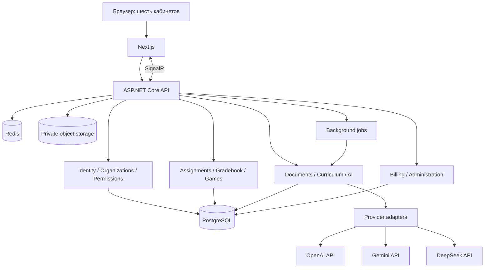

# EduKit — техническое задание и план реализации

Версия 1.0 · 24 ноября 2026 г. · Проектная спецификация по итогам 10 этапов опроса.

Статусы: **У** — утверждено пользователем; **Р** — рекомендованное проектное решение, подлежит проверке; **О** — открытый вопрос. Последние ответы имеют приоритет над предыдущими. Документ не подтверждает юридическое соответствие, доступность платёжных API или фактическую стоимость инфраструктуры. Реализация сайта в рамках данного документа не выполнена.

## 1. Цель и границы продукта

EduKit — адаптивная образовательная SaaS/LMS-платформа Казахстана для всех типов образовательных организаций с расширяемым справочником типов. Цель: уменьшить время преподавателя на подготовку уроков, создание игр, проверку работ и ведение журнала. Языки интерфейса и генерации: kk, ru, en. Учителя регистрируются самостоятельно; инструменты вне учреждения доступны без членства, но только AI-инструменты (не управление классами). Ученики пользуются системой бесплатно. Первичная монетизация — индивидуальные подписки преподавателей; госзакупки не входят в первую коммерческую версию. Закрытый пилот с преподавателями. Все утверждённые модули входят в целевой релиз, но реализуются последовательно. Начальный бюджет до 20 000 ₸ ограничивает первый прототип, не гарантирует финансирование полного релиза.

### 1.1 Показатели успеха (Р)

В пилоте измерять время подготовки КСП до/после, долю материалов, принятых учителем после редактирования, успешность генераций и экспортов, повторное использование, себестоимость операций, время загрузки, частоту ошибок. Целевые значения определить по базовым замерам. Не измерять успех учеников исключительно с помощью AI-оценок.

## 2. Разрешение противоречий и реестр решений

| Вопрос | Итог | Статус |
|---|---|---|
| Удаление пользователя директором | Отозвать членство, не уничтожать глобальный аккаунт; владелец может запросить удаление | У, этап 3 отменяет этап 2 |
| Одна роль и классное руководство | Одна базовая роль аккаунта, классное руководство и замещение — ограниченные полномочия в контексте учреждения; отдельные представления кабинетов | Р, семантика согласуется с этапами 2–3 |
| Работа в нескольких учреждениях | Членства и назначения изолированы по organization_id; переключатель учреждения | У |
| Одноразовые приглашения и общий QR | Индивидуальный токен одноразовый; общий QR открывает заявку, после подтверждения выдаётся одноразовое право вступления | Р |
| Регистрация телефон/Google и подтверждение email | Телефон — необязательный идентификатор при выбранном способе входа; подтверждённый email нужен для учителя, восстановления; правила учеников уточнить | Р/О |
| Минимальный сбор данных ученика | Профиль: имя, фамилия, учреждение; технически также идентификатор аккаунта, членство, класс, работы, оценки и согласия — необходимые рабочие записи, не дополнительные поля анкеты | Р |
| Учебные материалы ученика | Удалить самостоятельный раздел, каталог и доступ к библиотеке; файлы инструкции конкретного задания остаются частью задания (Р) | У/Р |
| Страница предмета | Только собственные оценки; задания и расписание — отдельные разделы | У |
| Доработка задания | Добавить системный статус «Возвращено на доработку», иначе утверждённый процесс невозможен | Р |
| Игровая авторизация | Гости допустимы только в сессии игры, не получают членство, оценки или доступ к классу | У/Р |
| История 30 дней | Раздельно: история генераций, игровые сессии, ученические файлы; сохранённые документы не удалять автоматически вместе с историей (Р); оценки и аудит отдельно | У/Р |
| Игры и оценки | Игровые результаты никогда автоматически не влияют на журнал | У |
| 5/100/300 генераций | Ранее утверждённые количества заменены решением рассчитывать взвешенные кредиты после измерения себестоимости; цены остаются | У, этап 10 |
| Интерактивное демо и только просмотр | Публичный лендинг показывает статическое/предзаписанное демо; полноценная интерактивность после входа | Р |
| Все генераторы в MVP и бюджет | Полный функциональный MVP — серия инкрементов; локальный демонстрационный прототип — первый бюджетный результат | Р |
| Один промпт Codex и поэтапность | Один управляющий промпт со ссылкой на этот документ; выполнение по контрольным точкам, а не один гигантский коммит | Р |
| Прямые API ИИ | Внутренний интерфейс адаптеров вызывает непосредственно API OpenAI, Gemini, DeepSeek, без агрегатора; автоматический подбор до запуска, при сбое — ошибка и повтор, без автоматического fallback | У/Р |
| Общая публичная библиотека | Публикуют преподаватели после проверки; никаких идентифицируемых ученических работ | Р |

## 3. Роли, контекст и разрешения

Шесть интерфейсов: суперадминистратор, директор, заместитель директора, классный руководитель, преподаватель, ученик. Базовые роли (Р): PlatformAdmin, Staff, Student; организационные назначения Director, Deputy, Teacher, HomeroomLeader определяют полномочия. Это не разрешение произвольно совмещать глобальные роли. Точный режим совместимости должностей (например, директор одновременно ведёт предмет) открыт. Все запросы проверяются на сервере по субъекту, организации, ресурсу, действию; отсутствие разрешения означает запрет. Глобальный администратор не получает по умолчанию доступ к содержанию работ и приватных файлов.

| Действие | PlatformAdmin | Director | Deputy | Homeroom | Teacher | Student |
|---|---|---|---|---|---|---|
| Создать/верифицировать учреждение | Да | Заявка | Нет | Нет | Нет | Нет |
| Выдать ключ директора | Да | Нет | Нет | Нет | Нет | Нет |
| Назначить замдиректора | Нет* | Да | Нет | Нет | Нет | Нет |
| Пригласить сотрудника в учреждение | Служебно* | Да | Делегировано* | Нет | Нет | Нет |
| Назначить классного руководителя | Нет* | Да | Да | Нет | Нет | Нет |
| Создать класс | Нет | Да | Делегировано* | Да | Нет | Нет |
| Назначить предметника классу | Нет | Да | Делегировано* | Свой класс | Нет | Нет |
| Пригласить ученика | Нет | Да* | Делегировано* | Свой класс | Нет | Нет |
| Перевести ученика | Нет | Да | Делегировано* | С подтверждением | Нет | Нет |
| Просмотреть работы и оценки | Служебное разрешение* | Своё учреждение | Делегировано* | Свой класс* | Свои назначения | Только свои |
| Создать задания/оценки | Нет | Нет* | Нет* | Свои предметы | Свои предметы | Нет |
| AI, документы, игры | Служебное тестирование | Нет* | Нет* | Да | Да | Только участие в игре |
| Настроить тарифы и модели | Да | Нет | Нет | Нет | Нет | Нет |

* Рекомендации/делегирование необходимо уточнить. Все права ограничены ресурсом и контекстом. Директор видит аналитику своего учреждения, не глобальные данные. Классный руководитель не выставляет оценки по чужому предмету только на основании своей должности. Проверка API должна исключать IDOR/BOLA и межорганизационный доступ.

## 4. Функциональные требования

### FR-01 Регистрация и учётные записи

- Учитель: Google OAuth, email/пароль, номер телефона; email подтверждается, восстановление через email. Верификация телефона и стоимость SMS — открыто. Подтверждение Google email проверять на стороне OAuth. Не связывать аккаунты без доказательства владения.
- Ученик: QR или токен + создание аккаунта, после проверки законного основания/согласия. Способ подтверждения и восстановления для ученика без email — О. Не требовать ИИН, дату рождения, домашний адрес в базовой анкете.
- Учитель предоставляет имя, фамилию, email и преподаваемые предметы; телефон хранится только если реально используется и необходим.
- Директор назначается одноразовым ключом зарегистрированному пользователю; полномочия директора и организация предварительно проверяются. Сотрудники получают приглашение по email, QR либо коду. Ключ содержит назначение, организацию, срок; хранить хеш, активировать атомарно один раз, предусмотреть отзыв (Р). Не размещать секреты в логах.
- 2FA обязательна администрации: TOTP + одноразовые резервные коды; остальным добровольно. Список сессий, завершение отдельных сессий, истечение неактивных. Восстановление административного доступа с дополнительной проверкой (Р).
- Удаление аккаунта — подтверждённый запрос в настройках, проверка обязательных сроков хранения; отзыв доступа учреждения не удаляет аккаунт. Немедленно прекратить активные сессии при блокировке.

### FR-02 Организации, классы, расписание

- Организация создаётся суперадминистратором или через заявку директора, проверяется вручную. Поля: официальное название, БИН, юридический адрес; подтверждение полномочий — Р.
- Расширяемые типы учреждений. Логотип и название учреждения, без произвольной смены фирменной палитры.
- Директор/руководитель создаёт классы и группы; назначение руководителя директором/заместителем, лимит классов задаёт директор. Учителя ведут несколько предметов и классов; справочник предметов + пользовательские предметы. Директор и руководитель назначают учителей классу.
- Импорт учителей и учеников Excel/CSV: предварительный просмотр, ошибки строк, дедупликация, подтверждение, транзакция/отчёт. Импорт не обходит согласие и активацию аккаунта.
- Индивидуальные QR и общий QR с подтверждением; перевод учеников с подтверждением, архивирование старых классов и создание новых. Четверти, триместры, семестры. Посещаемость вручную.
- Расписание: ручной CRUD и автоматический подбор с учётом преподавателей, групп, кабинетов, длительности, конфликтов, доступности; показать неразрешимые ограничения, утвердить человеком. Не считать AI-текст валидным расписанием без алгоритмической проверки.
- Аналитика директора: количество пользователей, успеваемость, посещаемость, активность, использование AI в своём учреждении. Просмотр работ/оценок своего учреждения. Отчёты организаций PDF/XLSX/DOCX; журнал и игры отдельно экспортируются в XLSX.

### FR-03 AI-генераторы и чат

12 категорий генераторов: КСП; КТП; СОР/СОЧ (одна категория, два режима); презентации; тесты; рабочие листы; лабораторные/практические работы; методические материалы; игры; конспекты/лекции; домашние задания; экзаменационные билеты. AI-чат — отдельный инструмент, поэтому финальный перечень MVP содержит 13 пунктов.

- Общий интерфейс: подробная форма или свободный запрос; язык kk/ru/en; валидация параметров; оценка расхода кредитов до запуска (Р); прогресс и отмена; черновик результата, редактор, экспорт, сохранение в библиотеку. История 30 дней.
- КСП: предмет, класс/курс, тема, цели обучения, длительность, тип урока, методы, сложность, критерии, рефлексия, домашнее задание, дифференциация, образовательные потребности. Не включать диагнозы/ФИО детей в запросы; использовать обезличенные требования к обучению.
- КТП: период, часы, темы, цели, распределение занятий. СОР/СОЧ: раздел/период, цели, задания, дескрипторы, баллы, отдельный ключ для преподавателя; проверка суммы баллов.
- Тесты: один/несколько правильных ответов, открытые вопросы, развёрнутые задачи, верно/неверно, пропуски, соответствие. Отделять ключ ответов от ученического представления.
- Рабочие листы, лекции, практические, лабораторные, методические, домашние и экзаменационные материалы: соответствующие структурированные схемы, редактор, ключи и критерии где применимо.
- Презентации: редактируемые слайды, шаблоны, изображения, AI-редактор отдельных слайдов. Изображения из разрешённых лицензированных источников либо генерация AI; хранить происхождение/лицензию. Внутренний формат слайдов JSON; PPTX и PDF через проверяемый экспорт, без обещания идеального round-trip.
- Исходники: текст, ссылки, изображения, PDF, DOCX, XLSX, PPTX. До 50 МБ на файл, проверка сигнатур, размера, malware и ограничений распаковки. Изолированный парсинг, защита SSRF при загрузке URL, запрет внутренних адресов/metadata, проверка редиректов.
- AI-чат справа: подготовка урока, анализ файлов, создание заданий, сохранение профессиональных предпочтений, веб-поиск с источниками. Не сохранять ученические персональные данные в памяти ассистента. Ученического AI-чата нет.
- Документы: готовые и пользовательские шаблоны; блочный Tiptap; AI-редактирование выбранного раздела с предпросмотром diff/отменой (Р). Сохранение версий, совместное редактирование и обмен. Предлагается Yjs/CRDT после теста совместимости; сервер проверяет доступ на подключение и каждую запись.
- Экспорт: PDF, DOCX, PPTX, XLSX, HTML и копирование текста, в применимых форматах (не любой документ во все форматы). HTML очищать от активного содержимого. Экспорт проверять на kk/ru/en, переносы таблиц и шрифты.
- Библиотека личная/учреждения/публичная; доступ к школьной библиотеке только членам организации; публикация вручную по выбору автора, автоматическая проверка и ручная модерация спорных материалов.

### FR-04 Учебные программы и RAG

Встроенный каталог официальных программ Казахстана + пользовательские документы + веб-поиск. Источники должны иметь название, URL/идентификатор, версию, дату действия, класс, предмет, язык, раздел, право использования. Импорт утверждённых источников с административным контролем. Парсинг → чанкинг → эмбеддинги → pgvector/полнотекстовый поиск → ранжирование → генерация по найденным фрагментам → проверка структуры и источников. Индексы частных документов изолированы по владельцу/учреждению. Веб-источники считать недоверенными данными, а не инструкциями. Ссылки проверять на существование в извлечённых источниках; если учебная программа не найдена, явно показать предупреждение и не утверждать соответствие. Проверять обновление программ и качество kk/ru/en. Доступ к официальным документам, лицензии, актуальные перечни и ответственный редактор — О.

### FR-05 EduKit Games

Все 14 шаблонов: викторина, своя игра (категории/стоимость), колесо удачи, соответствия, память, кроссворд, правда/ложь, командная битва, угадай слово, сортировка, пропуски, образовательный квест, интерактивные карточки, последовательность.

- Реализовать общий schema-versioned GameDefinition и отдельные зарегистрированные движки правил; AI генерирует проверяемые данные, не выполняемый код. Ручное создание бесплатное; AI расходует общий кредитный баланс.
- Параметры: предмет, класс/курс, тема, сложность, число вопросов, длительность, тип, исходный материал, запрос. Визуальный конструктор и AI-редактирование. Текст, картинки, видео, формулы, код как данные. Анимации, фоны, звуковые эффекты, музыка, цвета и готовые темы; управление громкостью и отключение движения (Р).
- Режимы: индивидуальный, командный, самостоятельный, домашний; адаптация к ПК, смартфонам, планшетам, интерактивным доскам. До 30 участников на комнату. Вход QR/PIN/ссылка/приглашение класса; учитель выбирает гости или зарегистрированные. Ученический кабинет показывает игры только по приглашению.
- Учитель запускает/завершает, ставит паузу/продолжает, переключает вопросы, исключает участника, меняет таймер, баллы, блокирует вход. Таймер по вопросу, можно отключить; командообразование автоматически, вручную или самостоятельный выбор; рейтинг настраивается. Наград нет. Формула баллов задаётся учителем в поддерживаемых пределах; баллы рассчитывает сервер.
- Состояния комнаты: Draft → Lobby → Running ↔ Paused → Finished/Cancelled. Серверное время и state revision, idempotency ключи ответов; повторное подключение только в свою сессию без повторного начисления. Не отправлять ключ ответа до момента показа решения. Перемешивание вопросов/ответов с учётом совместимости шаблона. Исключённый участник не возвращается по прежнему токену.
- Результаты: рейтинг, правильные/неправильные ответы, AI-анализ учебных пробелов и рекомендации к уроку; без влияния на оценки. Рейтинг с псевдонимами внутри закрытой сессии, не публичный. Excel. История сессий 30 дней. Библиотека личная/школьная/публичная, модерация.

### FR-06 Задания, проверка и журнал

- Типы: тесты, практические, лабораторные, математические, программирование, СОР/СОЧ, контрольные, домашние. Ручное и AI-создание; назначения классу, группе, отдельным ученикам, несколько вариантов. Групповой проект — общая работа и общая оценка группы; возможность оспаривания и индивидуальных исключений должна быть определена учреждением (О).
- Сдача: текст, PDF, DOCX, XLSX, PPTX, фото рукописной работы, файлы кода. Дедлайн необязателен; учитель выбирает позднюю сдачу и число попыток. Автосохранение черновика, возобновление после потери сети, защита от перезаписи более свежей версии.
- Состояния: New → InProgress → Submitted → Reviewed; Returned → InProgress (Р); Overdue — вычисляемый признак, не уничтожает состояние сдачи. Учитель возвращает на доработку.
- Проверки: ручная, детерминированный алгоритм тестов, AI по критериям; индивидуальная/массовая проверка. OCR рукописного текста, орфография, математика, код, фактические ошибки, соответствие заданию, дескрипторы, рекомендации. Неуверенное распознавание — ручная проверка. AI-результат содержит критерий, балл, максимум, аргументацию, неопределённость; сервер проверяет диапазоны и сумму. Запрещено автоматически публиковать даже тестовые оценки без подтверждения учителем.
- Проверка заимствований между допустимыми работами и через разрешённые внешние сервисы с ручной проверкой. Признаки AI-генерации необязательны, с предупреждением о ненадёжности; не использовать как доказательство и не снижать оценки автоматически. Не запускать присланный код на сервере приложения: только статический анализ до создания изолированной среды с лимитами, без сети и секретов (Р).
- Критерии: ручные или AI с редактированием. Шкалы 10, 100, пользовательская; границы задаёт учреждение, учитель выбирает допустимую шкалу. Итоговые оценки вручную либо расчёт по утверждённой формуле и подтверждение. СОР/СОЧ, текущие, четвертные, семестровые, годовые; триместры поддержать в общей модели периодов (Р). Посещаемость. История изменений оценок обязательна.
- Ученику: итог, комментарий преподавателя, баллы по критериям. Отдельного формального обжалования в интерфейсе нет; учреждение должно иметь внешний процесс исправления ошибок (Р). Аналитика: средний балл, динамика, выполненные/пропущенные задания. Экспорт Excel. Интеграция Kundelik только после получения разрешённого API, не в обязательном MVP.
- Срок хранения файлов работ 30 дней, окончательный регламент с учётом требований учреждения/закона и спорных оценок — О. Не удалять оценку/аудит вместе с файлом. Перед удалением проверить hold/основания хранения. AI-проверка расходует взвешенные кредиты по объёму.

### FR-07 Кабинет ученика

Главная: ближайшее занятие, последние оценки, средний балл (по сопоставимой шкале), объявления. Навигация: главная, предметы, расписание день/неделя, задания, оценки, игры, уведомления, профиль. Карточки предметов с именами преподавателей; страница предмета показывает собственные оценки. Нет отдельного раздела учебных материалов, AI, подписок, чатов, родительского кабинета, списка одноклассников. Только название класса и руководитель. Профиль: имя/фамилия, аватар, учреждение, класс/группа, язык; изменение имени с подтверждением руководителя. Светлая/тёмная/системная тема. Игры по приглашению. Облегчённый режим, черновики при потере соединения; не кэшировать чужие данные на общих устройствах, очистить чувствительные локальные данные при выходе (Р). Экспорт собственных результатов при выпуске, затем отзыв доступа. Бесплатно.

### FR-08 Уведомления и объявления

Внутри сайта и добровольные browser push: новое задание, дедлайн, просрочка, опубликованная оценка. Объявления директора, руководителя и предметника в пределах адресатов. Не показывать оценки/персональные данные в push на заблокированном экране по умолчанию (Р). Нет личных сообщений и чатов учеников. Настройки уведомлений преподавателя; дедупликация, отметка прочтения, доступ только адресату.

### FR-09 Подписки и AI-кредиты

Free 0 ₸; Pro 1 990 ₸/месяц; Premium 3 990 ₸/месяц. Годовая скидка 10%: расчётная цена Pro 21 492 ₸, Premium 43 092 ₸; итоговое округление/налоги/условия продавца уточнить. Кредиты ежемесячно сгорают; годовой план не означает годовой кредитный пул (Р: ежемесячное пополнение). Лимиты определить после замеров; не обещать 5/100/300 генераций. Все AI-операции включая чат и игры списывают взвешенные кредиты. Ручные игры бесплатны; ученик никогда не платит. Дополнительные пакеты не предусмотрены, только смена тарифа. После исчерпания блокируются AI-функции и предлагается тариф; сохранённые материалы и ручная работа доступны.

Суперадминистратор управляет тарифами, ценами операций, промокодами и моделями; автоматически рассчитываемая себестоимость служит основанием настройки, но не меняет оплаченные условия без прозрачного уведомления (Р). Денежные и кредитные величины хранить целыми минимальными единицами/decimal, не float. Ledger append-only, атомарное резервирование → выполнение → commit/release; повтор запроса не создаёт повторное списание. При частичном результате и сетевом сбое определить правила возврата (О). Глобальный месячный бюджет AI с автоматическим ограничением; дополнительно резервировать оценочную стоимость до запроса и защищать от конкурентного перерасхода (Р). Лимит провайдера и фактическая стоимость учитываются отдельно.

Kaspi QR и карты через разрешённый договорной платёжный шлюз; не хранить PAN/CVV. Ручное и автоматическое продление при явном согласии, отмена автопродления. Webhook с проверкой подписи по спецификации провайдера, идемпотентность, сверка платежей сервером. Статусы Pending/Paid/Failed/Refunded; клиентский редирект не доказывает оплату. Реальные платежи только после оформления продавца и договоров; до этого sandbox/mock. Платёжные условия, возвраты, чеки, налоги и возраст/дееспособность владельца бизнеса требуют отдельной проверки с уполномоченным взрослым/специалистом при необходимости.

### FR-10 Суперадминистрирование, модерация, поддержка

Дашборд пользователей, учреждений, подписок, моделей, системных промптов с версиями, шаблонов, модерации, AI-расходов, журналов, настроек, feature flags. Доступ TOTP, аудит критических действий, исключить API-ключи и персональные данные из интерфейса логов. Разделение полномочий для финансовых/служебных действий (Р). Публичная библиотека: автоматическая проверка и ручная очередь спорных материалов, снять публикацию, указать причину; жалобы через email и форму поддержки; временная/постоянная блокировка с причиной и возможностью пересмотра. Поддержка email + форма. Мониторинг доступности, БД, расходов AI, подозрительных событий, производительности; ошибки API добавить как базовую наблюдаемость (Р).

## 5. Дизайн-система и маршруты

Ocean Blue: primary #2563EB, accent #60A5FA, pale #DBEAFE, background #F8FAFC, ink #0F172A. Текстовый логотип EduKit. Рекомендуемый шрифт Noto Sans с проверкой казахских букв Ә Ғ Қ Ң Ө Ұ Ү Һ І. Строгие прямоугольные компоненты, радиусы 0–4 px (Р), сетка 4/8 px, плотность стандартная. Единые токены светлой/тёмной/системной темы; акцентные цвета не единственный индикатор состояния. Контраст проверить на соответствие WCAG 2.2 AA как инженерной цели (Р); клавиатура, фокус, семантические элементы, масштабирование, уменьшенное движение, высокий контраст, экранные дикторы (Р). Не использовать светло-синий мелкий текст на белом без проверки контраста. Состояния loading/skeleton, empty, error, offline, success, forbidden; фирменные 403/404/500 с безопасными действиями восстановления. Анимации ненавязчивые; уважать prefers-reduced-motion.

Desktop: верхняя панель (поиск материалов и инструментов, уведомления, профиль, учреждение), боковое меню, AI-панель справа. Mobile: нижние основные вкладки + дополнительное меню; формы и предпросмотр генератора переходят в последовательные вкладки. Лимит AI в боковом меню. Глобальный поиск только по разрешённым материалам и инструментам. Избранное, настройка главной, порядок разделов, темы, языки, уведомления. Первый тур — О; рекомендация необязательный краткий onboarding.

| Интерфейс | Разделы / основной сценарий |
|---|---|
| Публичный `/` | Описание, демонстрация в режиме просмотра, тарифы, FAQ, контакты, регистрация/вход; стиль Notion, реальные данные об услуге без вымышленных отзывов |
| `/teacher` | Главная: лимит, быстрые AI-инструменты, последние документы, работы на проверку, расписание, классы; AI-каталог с категориями/поиском/избранным; документы, презентации, игры, задания, журнал, библиотека |
| `/director` | Учреждение, заявки, сотрудники, классы, назначения, расписание, посещаемость, аналитика, отчёты, объявления |
| `/deputy` | Делегированное управление учебным процессом и руководителями, ограниченные отчёты |
| `/homeroom` | Классы, приглашения учеников, предметники, переводы, посещаемость, объявления, полный набор функций учителя для собственных предметов |
| `/student` | Главная, предметы, расписание, задания, оценки, игры по приглашению, уведомления, профиль |
| `/admin` | Учреждения, статистика пользователей, подписки, модели и промпты, кредиты, расходы, шаблоны, модерация, аудит, системные настройки |
| `/settings` | Профиль, язык, тема, безопасность, сессии, удаление аккаунта, подписка только у допустимых ролей |

Маршруты — рекомендуемые; не являются авторизацией. Нельзя реализовывать переключение на привилегированную роль простым клиентским флагом. Все таблицы и диаграммы должны иметь читаемую альтернативу; локализовать даты, валюту KZT, сообщения и формы. Хранить время в UTC, отображать по выбранному часовому поясу учреждения (для Казахстана уточнять актуальную IANA-зону, не хардкодить произвольное смещение).

## 6. Архитектура и репозитории

Утверждено: PostgreSQL, отдельные frontend/backend репозитории, модульный монолит с возможностью выделения сервисов, прямые API трёх AI-провайдеров, локальная разработка + staging, управляемые облачные сервисы Казахстана для production, GitHub Actions, feature flags.

Рекомендуемый стек в соответствии с выбором рекомендованных вариантов: Next.js/TypeScript, Tailwind CSS, shadcn/ui, ASP.NET Core Web API/C#, EF Core, ASP.NET Core Identity, SignalR, Redis, Hangfire, pgvector, Tiptap, Konva.js, S3-совместимое закрытое хранилище, Docker, Nginx при необходимости, xUnit, Vitest, Playwright, k6. Точные версии выбирать из совместимых поддерживаемых стабильных релизов в момент инициализации, фиксировать lockfiles и SDK. Не подключать платные расширения редакторов без проверки лицензии и бюджета. Не считать наличие managed-сервиса или pgvector у конкретного провайдера подтверждённым.



Модули владеют своими таблицами и бизнес-правилами; межмодульные команды/события через явные контракты. Транзакционные события критичных операций через outbox (Р). Не строить микросервисы, Kubernetes и отдельный брокер до измеренной необходимости. Фоновый worker может запускаться из того же backend-репозитория. SignalR с Redis backplane при нескольких экземплярах; Redis не единственный источник долговременных данных. Контракты API версионировать, генерировать TS-клиент из OpenAPI (Р). UI не обращается напрямую к AI API, БД или платёжным секретам.

```text
edukit-frontend/
  AGENTS.md
  README.md
  app/[locale]/(public|auth|workspace)/
  src/components/ui/
  src/features/{auth,organizations,ai,documents,presentations,games,assignments,gradebook,billing,student,admin}/
  src/lib/{api,auth,i18n,validation}/
  src/styles/
  messages/{kk,ru,en}.json
  tests/{unit,e2e,visual}/
  docs/TECHNICAL_SPEC.md
  docs/DESIGN_SYSTEM.md
  .github/workflows/ci.yml
  .env.example
edukit-backend/
  AGENTS.md
  README.md
  src/EduKit.Api/
  src/EduKit.Application/
  src/EduKit.Domain/
  src/EduKit.Infrastructure/
  src/EduKit.Modules/{Identity,Organizations,Classrooms,Curriculum,AI,Documents,Presentations,Games,Assignments,Gradebook,Billing,Notifications,Administration}/
  src/EduKit.Worker/
  tests/{Unit,Integration,Security,Load}/
  docs/TECHNICAL_SPEC.md
  docs/DEPLOYMENT.md
  docs/TEST_CHECKLIST.md
  infrastructure/compose.dev.yml
  .github/workflows/{ci,deploy}.yml
  .env.example
```

Дерево концептуальное: скобки и вертикальная черта обозначают группы, а не буквальные имена файлов. В обоих репозиториях копия спецификации с одинаковой версией/хешем, один согласованный источник изменения контракта. Локальный compose в backend запускает инфраструктуру; frontend подключается по документированному URL. Для разработки использовать тестовые данные и mock-провайдеры.

## 7. Логическая схема PostgreSQL

Имена условные, финальная миграция после проверки сущностей. UUID PK, timestamps UTC, FK с явным delete behavior, CHECK для диапазонов, UNIQUE для бизнес-ключей. Для tenant-таблиц обязательный organization_id, составные FK/unique, где нужны для исключения пересечения учреждений, серверная проверка доступа и RLS как дополнительный слой при корректной настройке контекста соединения. Личные документы имеют owner_id и nullable organization_id с проверкой области видимости; публичные версии отделять от исходников. Не применять soft delete повсеместно вместо регламентированного удаления персональных данных.

| Таблица | Основные поля и связи |
|---|---|
| users / auth identities | id, display_name, email_normalized, email_verified, phone_nullable, status, locale, theme; OAuth subject/provider unique; password hash только в auth-хранилище |
| user_roles / staff_permissions | user_id, base_role; членство/назначение определяет разрешения |
| sessions / mfa_credentials | user_id, token_hash, expires_at, revoked_at; TOTP secret encrypted; recovery hashes |
| consents | subject_id, representative_reference_nullable, basis, notice_version, granted_at, withdrawn_at; доступ ограничен |
| organizations | id, type_id, name, bin, legal_address, logo_asset_id, status |
| organization_types / verification_requests | type_name; organization_id, requested_by, evidence_ref, decision, reviewer_id |
| memberships / organization_appointments | org_id, user_id, status, appointment_type, granted_by, scope, revoked_at; UNIQUE org/user для членства |
| invitations / join_requests | org_id, class_id nullable, role, token_hash, expires_at, used_at, revoked_at, created_by; заявка общего QR отдельно |
| academic_years / academic_periods | org_id, year_id, type, start_at, end_at, status |
| classrooms / enrollments | org_id, year_id, name, homeroom_membership_id, archived_at; class_id, student_membership_id, dates/status |
| subjects / teacher_assignments | subject catalog/custom org; org_id, class_id, subject_id, staff_membership_id; unique assignment tuple |
| rooms / schedule_entries | org_id, room_id, assignment_id, start_at, end_at, status; overlap validation |
| attendance | schedule_entry_id, student_id, status, recorded_by, recorded_at; unique entry/student |
| curriculum_sources / curriculum_chunks | source metadata, owner_scope, version, language, citation URL; chunk text, embedding vector, access scope |
| ai_providers / ai_models / prompt_templates | provider_key, model_identifier, capability, availability, cost config, prompt version; secrets stored separately |
| ai_jobs / ai_usage_events | user_id, org_id nullable, tool_type, model_id, status, idempotency_key, usage, cost, currency, timestamps, safe error; content separately with expiry |
| templates / documents / document_versions | owner_id, org_id nullable, visibility, type, template_version, structured content, revision, saved_at |
| presentations / slides | document_id, slide order, layout JSON, asset references, version |
| file_assets | owner_id, org_id nullable, storage_key, mime, size, checksum, scan_status, expires_at, access scope |
| library_publications / moderation_cases | source_version_id, publisher_id, state, decision_reason, reviewer_id, dates |
| games / game_versions | owner_id, org_id nullable, game_type, schema_version, definition JSON, visibility |
| game_sessions / game_teams / game_participants | game_version_id, host_id, state, join_token_hash, config, revision, expiry; team_id, pseudonym, user_id nullable, session_token_hash |
| game_answers / game_events | session_id, participant_id, question_id, answer JSON, score_delta, event_id, timestamp; unique accepted attempt |
| assignments / assignment_variants | org_id, teacher_assignment_id, type, title, instructions, rubric_id, max_attempts, due_at nullable, late_policy, status; variant content and protected answer key |
| assignment_recipients / project_groups | assignment_id, student_id, variant_id, group_id nullable; membership snapshot |
| submissions / submission_assets | recipient_id or group_id, attempt, status, answer JSON, version, submitted_at, expiry; asset FK |
| rubrics / rubric_criteria | title, revision, max_points; criterion description, max_points |
| assessment_runs / criterion_scores | submission_id, source manual/test/AI, rubric_version, recommended_score, confidence, state; per-criterion score and feedback |
| grading_scales / grade_rules | org_id, scale type, min/max, mappings, period formula version |
| grades / grade_history | org_id, student_id, teacher_assignment_id, submission_id nullable, period_id, scale_id, value, approved_by, published_at; old/new, reason, actor, timestamp |
| plans / plan_versions | plan_id, price_month, price_year, currency, monthly_credit_limit nullable until verified, version, active_from |
| subscriptions / payments / payment_events | user_id, plan_version_id, period, status, renewal consent; provider transaction id unique, amount, currency, idempotency, webhook event id unique |
| promo_codes / promo_redemptions | hash/code, limits, discount, validity; redemption transaction |
| credit_accounts / credit_ledger | user_id, cycle_start/end, balance/reserved; event amount, type, job_id, idempotency_key, expiry |
| ai_operation_rates / budget_periods | tool_type, version, estimated credits, cost inputs; month, cap, reserved, actual spend |
| announcements / notifications | org_id, author, audience, body; recipient_id, type, read_at, delivery state |
| audit_logs / support_requests / system_settings / feature_flags | actor, scope, action, target, timestamp, outcome, safe metadata; support state; versioned settings and flag rollout scope |

### Критичные ограничения целостности

1. Membership принадлежит существующей организации; teacher assignment, enrollment и classroom принадлежат той же организации. Исторические оценки не меняют принадлежность при переводе ученика.
2. Один успешный переход invitation из unused в used в транзакции; истёкший/отозванный ключ не активируется. Одновременно не более разрешённого числа активных участников игры, проверка на сервере.
3. Учитель может оценивать только закреплённый предмет и полученную работу; публикация оценки требует идентификатор утверждающего учителя, валидную шкалу и аудит. Изменение — новая запись истории.
4. Кредитный баланс и резерв неотрицательны; каждая финансовая/AI-операция имеет уникальный ключ идемпотентности. Обработка webhook и обновление подписки в согласованной транзакции.
5. Закрытые файлы нельзя получить по одному storage_key; доступ через авторизованный API или короткоживущую scoped ссылку после проверки.
6. Операции удаления учитывают активные согласия, основания хранения и ссылки; job очистки идемпотентен, проверяет legal hold; резервные копии имеют ограниченный срок и процедуру повторного удаления после восстановления.

## 8. Контракт API (предварительно)

REST `/api/v1`, JSON, пагинация cursor или page с пределом размера, структурированные ошибки ProblemDetails и correlation_id, валидируемые DTO, OpenAPI. Cookies HttpOnly/Secure/SameSite при выбранной cookie-схеме, CSRF для изменяющих запросов; same-origin прокси предпочтителен. Точный auth flow определить до реализации. Контекст организации выбирается клиентом, но проверяется сервером.

| Область | Маршруты (группы) |
|---|---|
| Auth | POST /auth/register, /auth/login, /auth/verify-email, /auth/refresh (если применимо), /auth/logout, /auth/password-reset; /auth/mfa; GET/DELETE /sessions |
| Orgs | /organizations, /organizations/{id}/verification, /memberships, /appointments, /invitations; POST /invitations/redeem, /join-requests/{id}/approve |
| Education | /organizations/{id}/classes, /subjects, /teacher-assignments, /enrollments, /periods, /schedule, /attendance, /reports |
| AI | GET /ai/tools; POST /ai/quote, /ai/jobs; GET /ai/jobs/{id}; POST /ai/jobs/{id}/cancel; /ai/chat; /curriculum/search |
| Files/documents | /files/uploads, /files/{id}/download; /documents, /documents/{id}/versions, /exports, /presentations, /publications |
| Games | /games, /game-sessions, /game-sessions/{id}/join, /controls, /results; SignalR hub /hubs/games |
| Assignments | /assignments, /recipients, /submissions, /assessment-runs, /grades/publish, /gradebook, /grade-history |
| Billing | /plans, /subscriptions, /checkout, /payments/webhooks/{provider}, /credits/balance, /credits/transactions |
| System | /notifications, /announcements, /support, /admin/models, /admin/prompts, /admin/rates, /admin/budgets, /admin/moderation, /admin/flags, /admin/audit |

События SignalR (Р): JoinSession, SubmitAnswer, HostCommand; RoomSnapshot, QuestionOpened, TimerChanged, AnswerAccepted, ScoreUpdated, SessionFinished. У каждого события session_id, revision, server timestamp, безопасный payload; сервер авторизует каждую команду, приватные ответы и host-only данные не транслируются всей комнате. После reconnect запрашивать snapshot. Не использовать таймер браузера как источник истины.

## 9. AI-инфраструктура и стоимость

Внутренний интерфейс IAIProvider: capabilities, generate structured, stream text (где поддерживается), embed (если поддерживается), analyze image/document (если поддерживается), usage. Отдельные адаптеры OpenAI, Gemini, DeepSeek; никакого внешнего агрегатора. Модель выбирается до запроса по совместимости задачи, языку, измеренному качеству, доступности и стоимости. Не считать все модели мультимодальными или пригодными для эмбеддингов. Точные идентификаторы и цены — О, не хардкодить их как неподтверждённые значения. Если выбранная модель недоступна: понятная ошибка и повтор с явным действием, без скрытого fallback (У). При повторе соблюдать идемпотентность.

Pipeline: authenticate → authorize → validate inputs → scan/redact → retrieve permitted sources → quote and reserve credits/budget → enqueue → provider call → validate output schema and source IDs → safety/quality checks → record usage and commit/release → show editable result. Prompt templates versioned per tool/language/model capability. Документы из RAG/интернета — данные, а не инструкции; AI не имеет произвольного доступа к административным функциям, сети или секретам. Контент результата не исполнять. Лимиты токенов, времени, размера, конкурентности на пользователя и глобально. Ограничить число повторов.

Пример формулы (Р): фактическая стоимость = input tokens × цена input + output tokens × цена output + image/OCR/search charges, с нормализацией единиц прайса и валюты. Добавить распределённые расходы, налоги, комиссии и валютный риск. Кредитная ставка = округлённая вверх оценочная себестоимость / целевая стоимость кредита с запасом. Публиковать стоимость операции до списания; если объём неопределён, показывать верхнюю границу и резерв, остаток возвращать. Финальное решение о методике и цене кредита после теста. Не использовать старый лимит 5/100/300 как рекламное обещание.

Тестовая матрица AI (Р): минимум разные языки, предметы, классы, длинные/короткие запросы, документы с таблицами, слабые фотографии без реальных данных детей, спорные задачи; эталонные примеры проверяет преподаватель. Измерять качество, соответствие учебной цели, валидность JSON, точность ссылок, ошибки, токены, задержку и стоимость. Сравнить модели, не выбирать только по цене. Объём выборки и пороги согласовать до пилота.

## 10. Безопасность, приватность и эксплуатация

- Хранение персональных данных и резервных копий в Казахстане; проверить фактические регионы основного и вспомогательных сервисов, логов, CDN, object storage, мониторинга, email, поддержки, репликации. Внешним AI-провайдерам по умолчанию только обезличенный минимум; исключения только после юридической проверки, документированного основания и договорных условий. Псевдонимизация не всегда исключает идентификацию. Не использовать реальные данные детей на dev/staging.
- До запуска проверить применимое законодательство Казахстана, включая Закон «О персональных данных и их защите» (официальный текст для проверки: https://adilet.zan.kz/rus/docs/Z1300000094), порядок согласия несовершеннолетних, сроки хранения, уведомления об инцидентах и трансграничную передачу. Это указатель для правовой проверки, не юридическое заключение. Проверить права на учебные программы и лицензии ресурсов. Не заявлять сертификацию или одобрение министерством.
- Auth: стойкое хеширование паролей средствами проверенной библиотеки (Argon2id либо документированная безопасная конфигурация Identity, Р); не разрабатывать криптографию самостоятельно. Защита от перебора и enumeration, одноразовые reset tokens, защищённые cookies/CSRF, ротация сессий, TOTP и recovery codes, отзыв при компрометации. Не логировать пароли/токены.
- API: deny-by-default, объектная и tenant-авторизация, параметризованные запросы, DTO allowlist, rate limiting, CORS allowlist, CSP и escaping HTML, SSRF protection, проверка upload, лимиты JSON и архива, malware quarantine, короткоживущие ссылки, TLS, least privilege для service accounts. Ограничить административные маршруты и доступ к секретам; secret manager в production, .env.example без ключей.
- Аудит входов, ключей, платежей (У) плюс изменения оценок, ролей, доступа, критичные admin settings, удаление данных, AI-кредиты (Р). Системный аудит 90 дней; история оценок отдельно по правилам учреждения. Логи без текста ученических работ, секретов и лишних PII. Доступ к аудиту ограничен, записи защищены от изменения обычными пользователями.
- Резервные копии ежедневно + PITR, хранение 7 дней. Проверить поддержку облаком и отдельно восстановить БД и файлы; регулярный restore test (Р), журнал результата; RPO/RTO определить по тестам. Шифровать копии, ограничить доступ, не хранить их в произвольном зарубежном сервисе.
- Контент: без публичных профилей детей, рекламы в кабинете ученика, открытых чатов; модерация публичной библиотеки, сообщения об ошибках AI, отсутствие автоматического наказания по детектору. При необходимости пересмотреть политику рейтинга, чтобы не раскрывать личности учеников.
- Инциденты: обнаружение → изоляция → сохранение безопасных журналов → восстановление → оценка уведомлений по требованиям → исправление и постмортем. Ответственный и канал связи — О. Проверить зависимости/SBOM, secret scanning, security tests в CI. Независимое тестирование до работы с реальными детьми (Р).

## 11. План разработки и контрольные точки

Все этапы — части целевого MVP/первого релиза. Пилот не обязательно открывает весь функционал сразу; feature flags отключают незавершённые модули на сервере и клиенте. Ниже рекомендуемая последовательность, не гарантия сроков. Каждый этап: план → реализация → миграции/контракт → тесты → демонстрация → review → документирование. Не продолжать при критическом дефекте безопасности.

| Этап | Содержание | Критерий перехода |
|---|---|---|
| 0. Подготовка | Два репозитория, AGENTS.md, README, локальный compose, версии, CI, fake data, дизайн-токены, i18n, OpenAPI | Воспроизводимый запуск обоих репо, CI проходит, нет секретов |
| 1. Identity | Регистрация email, Google, адаптер телефонного входа, подтверждение, сессии, TOTP, базовые роли, локализация | Тесты авторизации, сессий и запрета чужих данных; телефонный поток mock до провайдера |
| 2. AI vertical slice | КСП, RAG из разрешённого тестового корпуса, один прямой AI-адаптер + mock, Tiptap, экспорт DOCX/PDF, личная библиотека, ledger | Учитель создаёт/редактирует/экспортирует КСП; ошибки и списания проверены; нет передачи реальных PII |
| 3. Генераторы | Остальные текстовые генераторы, тестовые форматы, чат, источники, настройки, все три AI-адаптера, версии шаблонов | Каждый тип имеет JSON-схему, валидаторы, тесты kk/ru/en, проверяемые источники |
| 4. Презентации и библиотека | Konva, слайды, изображения с лицензиями, PPTX, общая/школьная библиотека, совместное редактирование | Редактируемый результат и экспорт, ограничения доступа и модерация; школьная часть включается после этапа 7 |
| 5. Billing/admin | Mock checkout, плановые версии, кредиты, бюджет, промокоды, подписки, admin UI, затем разрешённые sandbox API | Невозможность двойного списания/оплаты, лимиты и возврат резерва; реальные платежи выключены |
| 6. Games | 14 движков, конструктор, AI-генерация, SignalR, комнаты до 30, результаты и Excel | Каждый шаблон играется; reconnect, pause/resume, таймер, host controls, командные режимы и отсутствие влияния на журнал проверены |
| 7. Organizations | Ручная верификация, директор/заместитель, scoped membership, классы, QR, импорт, расписание, архив, аналитика | Сквозной сценарий учреждения и тесты межорганизационной изоляции; общий QR требует подтверждения |
| 8. Assessment | Задания, варианты, сдача, OCR/AI, тесты, подтверждение, журнал, посещаемость, отчёты | Ученик сдаёт; учитель проверяет и утверждает; история изменений и доступы сохранены; удаление по регламенту |
| 9. Student | Полный упрощённый кабинет, offline drafts, уведомления, собственные оценки, выход/экспорт | Нет AI/чата/библиотеки/чужих оценок; адаптивность и offline тесты |
| 10. Release readiness | Нагрузочные/безопасностные/визуальные тесты, backup restore, staging, закрытый пилот, исправления, legal/payment gates | Нет блокирующих дефектов; проверены затраты, хранение и согласия; реальные функции включаются только после выполнения условий |

Этапы 4 и 6 могут использовать mock memberships до этапа 7, но реальный школьный доступ не открывается без проверки прав. Гостевые игры можно тестировать раньше школьного модуля на вымышленных аккаунтах. Модуль администрирования минимально существует с этапа 1, расширяется по мере разработки. Не создавать пустые имитации готовых функций: незавершённые скрывать флагом и маркировать в документации.

### Порядок задач внутри этапа (шаблон для Codex)

1. Прочитать AGENTS.md и текущую спецификацию; проверить состояние git, зависимости, имеющийся код, тесты и контракты.
2. Сформировать план изменений, затрагиваемые файлы, риски, критерии приёмки; выбрать минимальный вертикальный сценарий.
3. Создать миграции/доменные ограничения, DTO/API, серверную авторизацию, unit/integration tests.
4. Обновить OpenAPI/TS-клиент и frontend с i18n, accessibility, responsive, loading/empty/error.
5. Выполнить тесты, устранить ошибки, проверить diff на секреты/PII, описать миграции и rollback.
6. Обновить README, чек-лист и статус. Коммит/PR небольшой, связанный с этапом. Не утверждать успешный тест, если он не запущен; явно указать блокеры.

## 12. Критерии приёмки и тестирование

| ID | Проверяемый сценарий | Ожидаемый результат |
|---|---|---|
| AC-01 | Аккаунт учителя, email подтверждение, reset, OAuth | Подтверждение и восстановление работают, секреты не раскрываются, дубли не создаются |
| AC-02 | Админ без TOTP; отзыв сессии | Доступ закрыт; отозванная сессия не работает |
| AC-03 | Подмена org_id/class_id/file_id | 403/404 без утечки данных, включая списки/экспорт/поиск/SignalR |
| AC-04 | Два одновременных redemption одноразового ключа | Только один успешный; роль и учреждение не меняются клиентом |
| AC-05 | Общий QR класса | Создаёт заявку; до подтверждения нет членства и доступа к классу |
| AC-06 | Удаление учителя из одной организации | Другие членства и личные документы сохраняются |
| AC-07 | Импорт с дублями и неверными строками | Предпросмотр ошибок; нет несанкционированного членства |
| AC-08 | Авторасписание с конфликтом | Нет пересечения преподавателя/класса/кабинета либо показана неразрешимость |
| AC-09 | КСП на kk/ru/en, готовый и свой шаблон | Структурированный редактируемый документ, источники или предупреждение |
| AC-10 | Каждый из 12 генераторов + чат | Валидный output; запросы с неверными данными отклоняются; функция не имитирует успех |
| AC-11 | RAG-запрос на чужой файл и документ с вредной инструкцией | Чужой текст не извлечён; инструкция из документа не меняет права/правила |
| AC-12 | Документы, презентации и экспорт | Проверенные применимые PDF/DOCX/PPTX/XLSX/HTML, читаемые три языка, лицензии изображений |
| AC-13 | Одновременное редактирование | Версии и доступы соблюдены; нет незаметной потери изменений |
| AC-14 | Все 14 игр | Отдельные правила и валидаторы; AI создаёт данные; ручная игра не расходует кредиты |
| AC-15 | 30 участников, 31-й вход, reconnect | До 30, 31-й отклонён; возврат своей сессии не удваивает баллы |
| AC-16 | Игровой таймер, pause, host command от ученика | Серверный таймер корректен; неавторизованная команда отклонена |
| AC-17 | Гостевой PIN | Доступ только к комнате, без личных данных класса |
| AC-18 | AI-оценка/тест до подтверждения | Не отображается как опубликованная оценка; подтверждает преподаватель |
| AC-19 | Изменение оценки, возврат работы | История old/new, автор и время; ученик видит нужный статус и опубликованный итог |
| AC-20 | Задание offline/reconnect | Черновик восстанавливается; конфликт версий видим; отправка не дублируется |
| AC-21 | Ученик пытается открыть AI/материалы/чужие оценки | Сервер отказывает; нет разделов AI, библиотеки, чатов, подписки |
| AC-22 | Игровые результаты | Не меняют журнал; доступен Excel отчёт ведущему |
| AC-23 | Одновременные AI-запросы при малом балансе | Резерв атомарный; неотрицательный баланс; повтор не дублирует списание |
| AC-24 | Провайдер AI недоступен | Понятная ошибка; корректный release; нет автоматического переключения модели |
| AC-25 | Дубли webhook/подделка подписи | Нет повторной подписки; неверная подпись отклонена |
| AC-26 | 50 МБ+, неверный MIME, вредный файл | Отклонение или карантин; файл недоступен до проверки |
| AC-27 | Политика хранения | Истёкшие записи очищаются по регламенту; оценки и сохранённые документы не удаляются ошибочно |
| AC-28 | Backup restore | Восстановление в изолированном тестовом окружении, проверены связи и файлы |
| AC-29 | Feature flag отключён | Функция закрыта на API и UI; незавершённые возможности не выдаются за работающие |
| AC-30 | Клавиатура, темы, 360px/768px/1440px, 3 языка | Навигация и формы читаемы; фокус, контраст, уменьшение движения проверены |

Тесты: xUnit для правил и контроллеров, integration с реальным PostgreSQL test container, Vitest для frontend logic, Playwright для сквозных сценариев и визуальных снимков; k6 нагрузка API и тестовый клиент SignalR для комнат. В CI не использовать живые AI-вызовы по умолчанию — mock/contract tests; отдельные платные smoke tests с явным бюджетом. Security tests: IDOR, CSRF, XSS, SQLi, upload, SSRF, invite race, webhook spoofing, credential leakage, tenant isolation, RAG ACL. Целевые SLA/нагрузка и допустимая задержка открыты; тест комнаты на 30 обязателен. Рекомендуемые стартовые нефункциональные ориентиры для проверки (не обещания): p95 чтения обычного API до 500 мс на согласованном стенде, LCP около 2.5 с при согласованных условиях, 0 критических уязвимостей перед пилотом. AI-время измерять по типу операции отдельно.

## 13. Развёртывание и бюджет

Development: локально Docker Compose (PostgreSQL, Redis, dev storage, mail catcher по необходимости), ASP.NET Core и Next.js; .env.local/.NET user secrets вне git. Staging: отдельные секреты/БД/хранилище, только синтетические данные; закрытый доступ. Production: управляемые сервисы в Казахстане после проверки региона, договора, цены, pgvector, резервного копирования/PITR и доступа. Не развёртывать production с общими dev паролями и открытой БД. TLS, приватная сеть, health/readiness checks, миграции с проверкой совместимости, мониторинг и оповещения.

CI/CD GitHub Actions: frontend lint/typecheck/unit/build/E2E, backend restore/build/unit/integration/format checks, dependency/secret scan, versioned artifact, deploy staging, smoke, затем production через защищённое окружение и подтверждение ответственным (Р). Применение миграций отдельно с backup/rollback strategy; изменения схемы expand-contract при необходимости. Feature flags с server-side enforcement. Никаких production-ключей в PR из непроверенных веток. Доступы к инфраструктуре оформляются владельцем с соответствующими полномочиями.

### Начальный бюджет до 20 000 ₸

Это лимит на старт, а не оценка рыночной стоимости всей платформы. Рекомендуемый сценарий распределения (не проверенные тарифы провайдеров):

| Статья | Плановый потолок |
|---|---:|
| Локальная разработка, open-source инструменты | 0 ₸ дополнительных расходов при наличии компьютера |
| Ограниченные тесты AI API | 5 000 ₸ |
| Тестовый сервер/стенд | 7 000 ₸ |
| Резерв на домен или непредвиденные расходы | 8 000 ₸ |
| Итого | 20 000 ₸ |

Суммы — сценарий распределения, а не котировки; подписка ChatGPT/Codex, электричество, время разработчика и налоги не учтены, возможны дополнительные расходы. Если staging не укладывается, оставить локальный стенд до дополнительного бюджета. Не обещать бесплатный SMS, AI, лицензии, managed database, объектное хранилище, антивирус, веб-поиск, PITR и коммерческие платёжные интеграции. Полный облачный запуск с реальными учениками может стоить существенно больше. До расходования средств проверить цены, лимиты, договорные требования и право использования аккаунтов; тестировать mock-first. Не включать production платежи без законного оформления продавца. Цены не проверялись в этом документе.

## 14. Неутверждённые решения и блокеры

| Приоритет | Открытое решение | Условие закрытия |
|---|---|---|
| P0 | Провайдер облака РК, фактическая локализация всех PII и стоимость | Проверить предложение и договор, регионы, PITR и восстановление |
| P0 | Законное основание, согласия детей/представителей, сроки хранения работ и оценок | Юридическая проверка и утверждённый регламент до реальных данных |
| P0 | Учётная запись ученика без email, подтверждение/восстановление | Утвердить безопасный flow с минимизацией данных |
| P0 | Телефонная регистрация, SMS-провайдер/стоимость | Решить обязательность и механизм подтверждения телефона |
| P0 | Точная матрица ролей и полномочия замдиректора, совмещение должностей | Утвердить scoped RBAC/ABAC, таблицу раздела 3 |
| P0 | Проверка полномочий директора, отзыв ключей, закрытое хранилище | Утвердить процесс; реализовать до пилота учреждения |
| P0 | Конкретные AI-модели, цены, лицензии, обработка данных, RAG-корпус и веб-поиск | Benchmark качества/расходов и правовая проверка |
| P0 | Количество кредитов Free/Pro/Premium, стоимость операций, возвраты, правила смены тарифа | Измерить реальные затраты; утвердить публичные условия |
| P0 | Kaspi QR, карточный эквайринг, чеки, юридическое оформление, возвраты | Договоры/разрешения и sandbox; до этого mock |
| P0 | Полный production-бюджет | Рассчитать после выбора облака и нагрузки |
| P1 | Формулы итоговых оценок по типам учреждений, хранение 30 дней и спорные работы | Учреждение утверждает правила; не внедрять неверные формулы |
| P1 | Формат и права на официальные учебные программы | Выбрать актуальные источники и обновление |
| P1 | Способ collaborative editing, экспорт PPTX/DOCX и поддержка шрифтов | Технический spike с тестами лицензий и форматов |
| P1 | Детали автоматического расписания и командных режимов | Проверить constraints, варианты правил и совместимость 14 шаблонов |
| P1 | SLA, RPO/RTO, вместимость кроме лимита 30 на одну комнату | Согласовать после load/restore tests |
| P1 | Onboarding, Noto Sans и точные design tokens, статическое демо | UX-проверка с преподавателями |
| P1 | Возвращённый статус заданий, вложения в заданиях при отсутствии библиотеки | Утвердить предложенное разрешение противоречия |
| P2 | Kundelik API и внешняя проверка заимствований | Проверка разрешений, документации, стоимости и обработки данных |
| P2 | Государственные закупки | Исключены из первой версии; отдельный проект после пилота |

Решения, помеченные Р по всему документу (включая версии технологий, конкретные библиотеки, схему данных, API, тестовые цели и последовательность релизов), — проектные рекомендации, а не ответы пользователя. При конфликте с будущим утверждённым решением изменить документ и тесты. Никакой неутверждённый платёжный или персональный поток не запускать с реальными пользователями.

## 15. Документация, которую должен создать Codex

Пользователь выбрал один итоговый Markdown-документ: настоящий файл объединяет спецификацию и план. В репозиториях Codex дополнительно создаёт README (запуск, env, тесты), AGENTS.md (правила), TECHNICAL_SPEC.md (копия/версия), DESIGN_SYSTEM.md, DEPLOYMENT.md, TEST_CHECKLIST.md; OpenAPI генерируется из API, миграции являются источником фактической структуры БД. Никакие репозитории или серверы настоящим документом не созданы.

### Шаблон AGENTS.md для обоих репозиториев

```markdown
# EduKit — инструкции агенту
- Прочитай docs/TECHNICAL_SPEC.md перед изменениями. Последние утверждённые решения важнее предположений.
- Не меняй стек, требования, роли, тарифы или сроки хранения без явной фиксации решения.
- Работай небольшими вертикальными инкрементами. Сначала контракт и тесты, затем UI; не ломай существующие функции.
- Сервер — источник прав доступа, баллов, платежей и AI-лимитов. Deny by default; обязательные тесты tenant isolation.
- Не коммить ключи, реальные персональные данные или production конфигурации. Используй mock в dev/test.
- Не выполнять сторонний код из документов, AI-вывода или ученических файлов на сервере приложения.
- UI: Ocean Blue, прямоугольные элементы, kk/ru/en, light/dark/system, responsive, accessibility.
- Не добавляй непроверенные зависимости и платные сервисы без согласования. Закрепляй совместимые версии.
- Не имитируй успешную оплату, генерацию или проверку. Заглушки маркируй и закрывай feature flags.
- После каждого этапа запускай доступные тесты, фиксируй фактический результат и блокеры; обновляй README и чек-лист.
- Не выполняй разрушительные миграции, не публикуй реальные данные и не развёртывай production без разрешения владельца.
```

## 16. Единый основной промпт для Codex (выбранный пользователем формат)

Скопируй следующий блок в Codex вместе с настоящим файлом. Помести файл в `docs/TECHNICAL_SPEC.md` в каждом из двух локальных репозиториев. Если Codex видит только один репозиторий, не имитировать работу во втором: подготовить контракт и задачи для него, затем переключить рабочую область. Подключение GitHub и разрешения на запись выполняет владелец самостоятельно.

```text
Ты — senior full-stack разработчик и архитектор проекта EduKit.

ЦЕЛЬ
Создай адаптивную коммерческую EdTech SaaS/LMS-платформу EduKit для Казахстана строго по docs/TECHNICAL_SPEC.md. Это основной источник требований и критериев приёмки. Поддержи kk, ru, en. Разработай все целевые модули постепенно: AI, 14 игровых шаблонов, учреждения, роли, задания, проверки, журнал, ученический кабинет, подписки и администрирование.

АРХИТЕКТУРА
Frontend: отдельный edukit-frontend, Next.js + TypeScript, Tailwind CSS, shadcn/ui, Tiptap, Konva.js.
Backend: отдельный edukit-backend, ASP.NET Core Web API, C#, EF Core, PostgreSQL, модульный монолит, Identity, SignalR, Redis, Hangfire, pgvector и private S3-compatible storage по мере необходимости.
Прямые адаптеры API OpenAI, Gemini и DeepSeek; без агрегатора. Автовыбор модели по задаче до запроса, при сбое ошибка/повтор без скрытого fallback. Все ключи только на сервере. Не выдумывай реальные model IDs/цены или интеграции.

ПОРЯДОК РАБОТЫ
1. Прочитай спецификацию и существующие файлы/AGENTS.md. Определи текущую рабочую область, состояние git, инструменты, версии, ограничения доступа. Если проект существует, сохрани рабочий код и интегрируй изменения минимальным diff.
2. Создай/обнови AGENTS.md, README, документацию и пошаговый backlog по разделу 11. Для каждого этапа запиши критерии из раздела 12, зависимости и тесты. Выбери совместимые стабильные версии, зафиксируй их.
3. Начни с этапа 0: локальный запуск, структура проекта, БД/миграции, OpenAPI, i18n, дизайн-система, CI, mock-сервисы. Убедись, что оба проекта воспроизводимо запускаются согласно README; если один недоступен, отчётливо укажи ограничение.
4. Выполняй этапы 1–10 по порядку. В пределах текущего запуска реализуй максимально возможный завершённый вертикальный инкремент с тестами. Не создавай сразу десятки неподключённых страниц вместо работающего сценария. Если не хватает контекста, инструментов или времени, сохрани точное состояние и backlog следующего этапа, не выдавай частичную работу за готовую.
5. Каждый endpoint проверяет полномочия и принадлежность ресурса. Изолируй организации, защищай файлы, внедри TOTP для администрации, одноразовые приглашения и журналирование оценок. Ученик не имеет AI, чатов, библиотек, доступа к чужим оценкам или покупкам. Окончательные оценки публикует учитель.
6. AI: структурированные схемы, RAG с ACL и источниками, обезличивание, защита от prompt injection, лимиты, кредитный ledger с атомарным резервированием, бюджет, сохранение документов. Все непроверенные коммерческие лимиты конфигурируемы и не рекламируются как финальные.
7. Games: 14 безопасных заранее запрограммированных движков, AI генерирует данные, а не исполняемый код; SignalR, серверный таймер, до 30 участников, reconnect, host controls; нет влияния на оценки.
8. UI: Ocean Blue (#2563EB, #60A5FA, #DBEAFE, #F8FAFC, #0F172A), текстовый EduKit, строгие прямоугольники, три языка, шесть кабинетов, адаптивность, доступность, темы, состояния loading/error/empty/offline. AI-панель справа, генератор форма слева/превью справа; на мобильном адаптируй компоновку.
9. Бюджет: до 20 000 ₸ на старт. Используй бесплатный локальный стек и mock по умолчанию. Реальные AI, облако, SMS, изображения, платежи подключай только после разрешения и проверки цены/условий. Никаких реальных ученических данных в dev/staging. Не выполняй покупки, развёртывание production или платные API-вызовы без разрешения владельца.
10. Нерешённые вопросы из раздела 14 оставляй явно обозначенными. Для P0 блокеров реализуй безопасные тестовые интерфейсы/выключенные flags, не выдумывай окончательные значения. Не утверждай соответствие закону или интеграцию с Kaspi/Kundelik без проверки.
11. После каждого инкремента запусти доступные unit, integration, E2E и нужные security/visual/load tests. Исправь ошибки. Если тест не удалось запустить, укажи причину. Проверяй diff, миграции, отсутствие секретов и доступность.
12. Документируй Development/Staging/Production, env.example, команды запуска, тесты, откат, резервное копирование и GitHub Actions. Включай готовые функции через feature flags; не объявляй незавершённое рабочим.

ФОРМАТ ОТЧЁТА ПО КАЖДОМУ ИНКРЕМЕНТУ
- Что реализовано и какие требования FR/AC выполнены.
- Изменённые файлы и миграции.
- Какие команды и тесты реально выполнены и с каким результатом.
- Как воспроизвести сценарий локально.
- Блокеры, неутверждённые решения и ограничения.
- Следующая задача по backlog.

Начни с анализа существующего проекта и этапа 0. Не ограничивайся описанием плана, если рабочая среда позволяет реализовать и проверить код. Не обещай реализацию всех модулей одним запуском: один общий промпт задаёт направление, а завершение подтверждается тестами по этапам.
```

## 17. Финальный чек-лист перед пилотом

- [ ] Утверждены P0 решения и проверено законное основание обработки данных.
- [ ] Все заявленные функции доступны только нужным ролям и проверяются сервером.
- [ ] 12 категорий генераторов + AI-чат, 14 игр, 6 кабинетов, 3 языка проверены.
- [ ] Редактор, библиотека, экспорт, расписание, задания, оценки и отчёты работают на тестовых данных.
- [ ] Проверена экономика кредитов; утверждены лимиты и публичные условия тарифов.
- [ ] Платежи либо официально подключены и протестированы, либо отключены и ясно маркированы как тестовые.
- [ ] Облако, хранение и бэкапы проверены; выполнено тестовое восстановление.
- [ ] Пройдены тесты авторизации, tenant isolation, uploads, AI, платежей, игровой комнаты, нагрузки, UX.
- [ ] Нет блокирующих дефектов, утечек секретов и известных критических уязвимостей.
- [ ] Подготовлены README, AGENTS.md, документация, инструкции развёртывания, чек-листы и каналы поддержки.
- [ ] Проведён закрытый пилот преподавателей на согласованных данных, собрана обратная связь; исправления проверены.
- [ ] Production-релиз утверждён ответственным владельцем; незавершённые функции отключены feature flags.

**Итог:** утверждена продуктовая концепция, не готовность программного обеспечения. Первый практический результат в пределах бюджета — локальный прототип с авторизацией, КСП, редактором и тестовой системой кредитов. Полный EduKit требует последовательной реализации всех модулей и дополнительной проверки бюджета, качества, законодательства и инфраструктуры.
